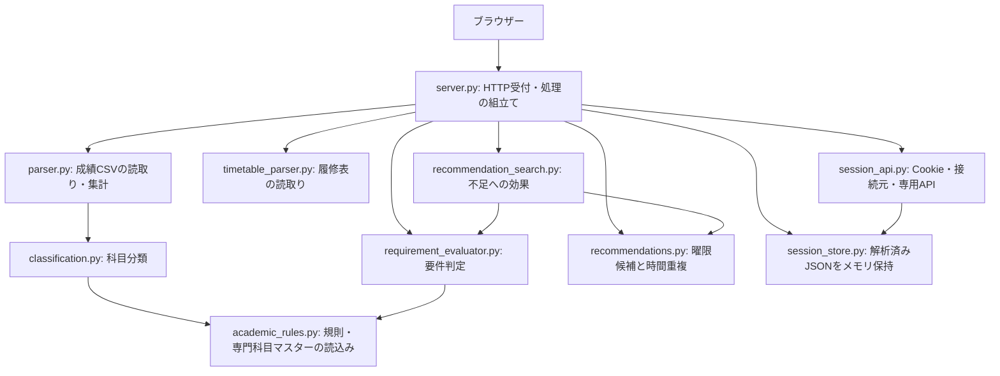
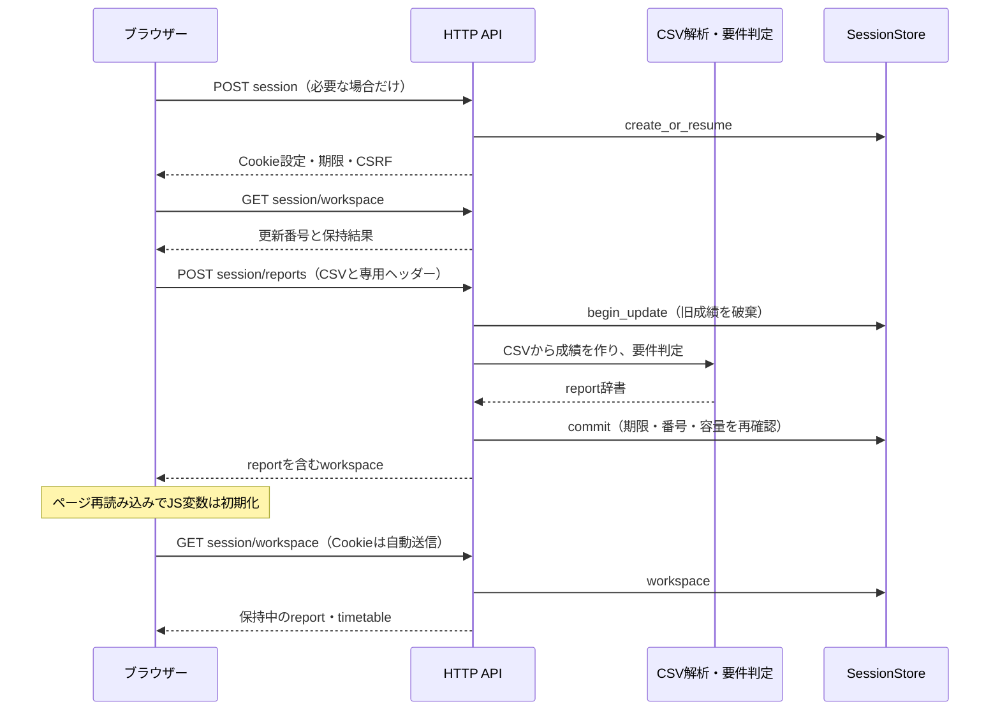

# サーバー側コードの読み方と処理の流れ

作成日：2026-11-11。対象コード：コミット`38a1734`。

Pythonの変数・関数・`if`・`for`を学んだ段階から読めるように、使用技術、ファイルの役割、具体的な入力と戻り値を順に説明する。実装を調べたレポートであり、この作業では学務規則やアプリケーションの処理を変更しない。SQLite・共有評価は保留中で、現在のセッションにDBは使っていない。

具体的な対象ファイルの列挙がなかったため、プロジェクト直下のPython全12ファイルと、API契約・生成スクリプト・起動設定を対象にした。学生本人のCSVは参照せず、以下のデータ例は架空または説明用の省略形とする。

関数を一つずつ調べたい場合は、別冊の[関数の入力・戻り値一覧](backend-function-reference.md)を使う。ソースへのリンクはリポジトリ内の相対リンクで、行番号は対象コミットのもの。ソースを更新すると行番号は変わる。

原文を先頭から一つずつ追う場合は、[全20ファイルの逐次解説版（HTML）](backend-source-walkthrough.html)を開く。原文コード5,510行を省略せず掲載し、意味のまとまりの開始行へ説明を付けた。214関数・メソッドには入力・戻り値・目的も対応付けている。ファイル単位で開閉でき、関数名から該当行へ移動できる。外部通信・インストールを必要とせず、Pythonコードを実行するページではない。

## 1. 最初に理解する全体像

サーバーの仕事は、大きく分けると次の5つである。

1. ブラウザーからのHTTPリクエストを受け取る。
2. CSVを読み取り、Pythonの辞書とリストに変換する。
3. 科目を分類し、JSONに書かれた進級・卒業条件と比較する。
4. 時間割と開講カタログから教養候補を探す。
5. 必要な場合は解析結果だけを短時間メモリに保持し、再読み込み後に返す。



この図の矢印は処理や関数の呼出し関係を示す。たとえば、分類器が規則を読み込んでも、その規則を編集するわけではない。

### ファイルを読む順番

最初から全ファイルを上から順番に読む必要はない。

| 順序 | 読む場所 | 分かること |
| --- | --- | --- |
| 1 | 本書の第2・3節 | ライブラリとPython記法の意味 |
| 2 | [server.py](../server.py#L421)の`create_report` | CSVから応答を作る大筋 |
| 3 | [parser.py](../parser.py#L78)の`parse_csv_bytes` | CSVのどこから何を取り出すか |
| 4 | [classification.py](../classification.py#L116)の`classify_course` | 専門・教養などの分類 |
| 5 | [requirement_evaluator.py](../requirement_evaluator.py#L559)の`_evaluate_requirement` | 条件別の関数へ処理を振り分ける方法 |
| 6 | 第8節と[session_store.py](../session_store.py) | リロード復元と期限の仕組み |
| 7 | 第9節の推薦処理 | 既存の判定器をどう再利用するか |
| 8 | `server.py`前半、API契約・生成コード | 受付の細部、セキュリティ、開発用処理 |

## 2. フレームワーク・ライブラリが担当すること

すべてを「フレームワーク」と呼ぶと役割が見えにくくなる。FastAPIはWebアプリケーションの枠組み、UvicornはHTTP通信を受け持つサーバー、python-multipartは送られてきた本文を分解するライブラリである。

| 技術 | このプロジェクトで提供している機能 | 自分たちで書いている処理 |
| --- | --- | --- |
| FastAPI | URLとPython関数の対応付け、`Request`、例外処理の登録、起動・停止処理、ルーター・ミドルウェアの組込み | CSVの意味、大学の規則、単位配賦、推薦、保持期限 |
| Uvicorn | ポートでHTTPを待ち受け、FastAPIアプリへ要求を渡し、応答をブラウザーへ送る | どのURLで何を返すか、判定アルゴリズム |
| Starlette | FastAPIの基盤。`StaticFiles`、`JSONResponse`、CORS、ヘッダー操作、ASGIの型など | 返すデータ、許可する接続元、追加する保護ヘッダー |
| python-multipart | multipart本文の境界・ヘッダー・本文を読み、登録した関数を呼ぶ | どの入力を採用するか、5 MiB上限、重複の拒否、CSVの解析 |
| Pydantic | API応答の型定義と、開発時の型・値の検証、JSON Schema生成 | 応答の組立て、学務判定。現在のAPIに`response_model`の自動変換は入れていない |
| jsonschema | 開発時にJSON Schemaと応答例の一致を検証 | 規則やJSON自体の作成。Webアプリの実行依存には含めない |
| pytest | `test_...`関数の実行、`assert`の失敗表示、テスト用の準備・後片付け | 境界値、架空CSV、期待する判定などのテスト内容 |
| httpx2 | テスト・契約生成からHTTP風にAPIを呼ぶ。ASGITransportではTCP通信せずアプリを直接呼べる | テストする入力、確認する応答 |
| pdfplumber | 開発時に公式の公開PDFの表・文字を取り出す | 列の解釈、対象科目の絞込み、開講カタログJSONの生成 |

`requirements.txt`は通常起動用、`requirements-dev.txt`はテスト・API契約生成用、`requirements-catalog.txt`は公開PDFからのカタログ生成用である。通常のCSVアップロードのたびにPDFを読んだりWebを検索したりはしない。

### FastAPIが関数を呼ぶまで

[server.py:420](../server.py#L420)には次の記述がある。

```python
@app.post("/api/v1/reports")
async def create_report(request: Request) -> dict:
    ...  # ここでは本文を省略。実際の処理は第4節で追う。
```

- `@app.post(...)`は、指定URLへのPOSTをこの関数へ対応付ける登録処理。
- `request`はブラウザーの要求を表すオブジェクト。本文やヘッダーを読む入口になる。
- `async def`は、通信などの待ち時間を他の処理へ譲れる関数の定義。
- `-> dict`は「辞書を返す」という型の注釈。これだけで辞書の全項目を検証するわけではない。
- この関数が辞書を返すと、FastAPI側がHTTP応答用のJSONへ変換する。

ブラウザーがPythonの関数名を指定しているのではなく、URLとHTTPメソッドを指定し、FastAPIが登録表を見て関数を選ぶ。

Uvicorn起動時の`server:app`は「`server.py`というモジュールの`app`オブジェクトを使う」という意味である。

### 通信の用語も区別する

| 用語 | このアプリでの具体例 |
| --- | --- |
| リクエスト | ブラウザーがPOSTで成績CSVを送る、GETで保持結果を取りに行く、といった要求 |
| レスポンス | サーバーが返すHTTP番号・ヘッダー・JSON本文 |
| ヘッダー | 本文以外の通信情報。Content-Type、Cookie、X-CSRF-Token等 |
| 本文・body | CSVを含むmultipartや、応答のJSON本体 |
| HTTPステータス | 200は成功、401は有効セッションなし、403は検証拒否、409は更新競合、422は入力不正等 |
| Origin | スキーム・ホスト・ポートの組合せ。localhostでも8000番と5173番は別Origin |
| CORS | 別Originからブラウザーが応答を読めるかを管理する仕組み。本人認証ではない |
| CSRF対策 | 意図しない接続元から、ブラウザーのCookieだけを利用して操作されることへの対策 |
| ASGI | UvicornとFastAPIなどのPythonアプリが、要求・応答を受け渡すためのインターフェース |

GET・POST・DELETEという文字だけでセキュリティや処理内容が自動的に決まるわけではない。各入口で実装している検証と処理を読む必要がある。

## 3. 読む前に知っておきたいPythonの記法

### データの姿が3回変わる

| 場面 | Python上の型 | 例と意味 |
| --- | --- | --- |
| 受信直後 | `bytes` | ファイルのバイト列。まだ列名や単位という意味はない |
| 文字コード変換後 | `str` | CSVの文章。日本語の文字として扱える |
| CSV解析後 | `list`・`dict` | 行や科目を要素・キーで参照できる |
| HTTPへ返すとき | JSON | Pythonの辞書をブラウザーとやり取りする形式へ変換する |

Pythonの辞書とJSONは似ているが別物である。Pythonの`None`はJSONでは`null`、`True`は`true`になる。`json.dumps(...)`は辞書から文字列を作り、`json.loads(...)`はJSON文字列やバイト列から辞書などを作る。

```python
# 架空データの説明例。実在する学生情報を出力しない。
course = {"name": "架空の教養科目", "credits": 2, "status": "passed"}
credits = course["credits"]           # 2
missing = course.get("course_code")  # キーがないのでNone
```

### このプロジェクトでよく出る記法

| 記法 | 意味 | 読むときの注意 |
| --- | --- | --- |
| `dict[str, str]` | 文字列キー・文字列値の辞書という型注釈 | 実際の中身を作るコードではない |
| `str \| None` | 文字列か、値なし | `None`は空文字列や0とは違う |
| `async def` / `await` | 非同期関数／その処理の完了を待つ | `await`があるだけでCPU計算が別スレッドになるわけではない |
| `@app.get` / `@router.post` | HTTPの入口を登録 | GETは取得、POSTは解析・検索・作成など、DELETEは削除に使っている |
| `@dataclass` | データを持つクラスの初期化などを自動生成 | `ReportUpload`等は値をひとまとめに運ぶ箱 |
| `frozen=True` | 生成した箱のフィールドを通常の代入で変更させない | 中の辞書まで自動的に変更不能になるわけではない |
| `field(default_factory=...)` | インスタンスごとに新しい辞書・バッファを作る | 受信データを別の入力と共有しないためにも必要 |
| `replace(session, revision=...)` | dataclassから一部を変えた新しい箱を作る | 元の箱を直接書き換えない |
| `@property` | メソッドの計算結果を属性の形で読む | `session.data_size`と書き、末尾に`()`を付けない |
| `@classmethod` | クラスを受け取るメソッド | `SessionSettings.from_environ()`が設定オブジェクトを作る |
| `@staticmethod` | インスタンスの`self`を使わないメソッド | トークンのハッシュ化などに使用 |
| `**classification` | 辞書のキーと値を別の辞書へ展開 | 分類結果を科目データへまとめる |
| `def f(raw, *, profile=None)` | `*`以降は名前を指定して渡す引数 | `f(raw, profile=...)`と書く |
| `nonlocal current` | 内側の関数から外側の関数の変数を代入更新する | multipartの各コールバックが同じ作業状態を扱う |
| `set` / `frozenset` | 重複のない集合／変更不能な集合 | 許可フィールド、既出番号、占有時間の比較に使用 |
| `{... for ...}` / `[...]`内の`for` | ループで集合・書・リストを作辞る内包表記 | 通常の`for`を短く書いたものとして読む |
| `raise ApiError(...)` | 通常の処理を中断して例外を渡す | 登録した例外ハンドラーがエラーJSONへ変換する |
| `with self._lock:` | ロックを取って処理し、終わると解放する | 同時更新でストアの数値・内容が食い違うことを防ぐ |
| `_read_upload`等の先頭`_` | 内部用という命名上の目印 | 呼出しをPythonが禁止する記号ではない |

`Decimal`は単位数の加減算で小数誤差を避けるために使う。集計中は`Decimal`、JSONへ返す直前に整数または小数へ変換する。

`if __name__ == "__main__":`の内側は、そのファイルを直接実行したときの入口。`import server`したときはこの部分を実行しない。DockerはUvicornから`server:app`を読み、`python server.py`はファイル末尾の起動処理を使う。

## 4. `server.py`：要求を受け、部品を順番につなぐ

ソース：[server.py](../server.py)。単位のルールをすべて実装するファイルではなく、HTTP受付・入力検証・各部品の呼出し・応答の組立てを担当する。

### 4.1 成績CSVの処理の中心

`create_report`の流れを、途中を省略して並べると次のようになる。

```python
upload = await _read_report_upload(request)
profile = _selected_profile(upload.fields.get("profile_id"))
report = parse_csv_bytes(upload.raw, profile=profile)
# 在学期間と、その値の出所を決める処理が入る
report["evaluations"] = evaluate_supported_requirements(
    report,
    residence_years=residence_years,
    residence_years_source=residence_years_source,
    profile=profile,
)
return report
```

| 値 | この時点で取得したい情報 |
| --- | --- |
| `upload.raw` | 送信されたCSVのバイト列 |
| `upload.fields` | `profile_id`・任意の`residence_years`という文字列入力 |
| `profile` | 選択された入学年度・プログラムの分類・要件データ |
| `report` | 学生情報、科目、取得単位の単純集計。解析直後の`evaluations`は空 |
| `report["evaluations"]` | 学年別に表示する進級・卒業条件の比較結果 |
| `report["evaluation_context"]` | 在学年数、入力値の出所、表示した要件ID |

`profile_id`は規則を選ぶIDであり、学生本人のIDではない。所属の文字列だけから別年度・別プログラムへ自動で切り替える処理ではなく、選択されたプロファイルを使う。所属と選択対象が一致するか確認できない場合は注意書きを加える。

在学期間は、明示入力があればそれを使い、なければ「留年・編入なし」という前提でCSV学年を使う。どちらも分からなければ`None`にし、評価器へ判断不能として渡す。

### 4.2 なぜCSV受信のコードが長いのか

ブラウザーはファイルを`multipart/form-data`という、複数の入力を境界で区切る形式で送る。CSVファイル、対象プロファイル、在学期間を一つの要求へまとめられる。

`_read_upload`はpython-multipartへ、`on_part_begin`・`on_headers_finished`・`on_part_data`などの関数を登録する。ライブラリが本文を読み進めると、該当する関数が呼ばれる。これをコールバックという。

```text
request.stream()で本文の一部分を受信
  → parser.write(chunk)
    → 部分開始：on_part_begin
    → ヘッダー確定：on_headers_finished
    → 本文の一部：on_part_data
    → 部分終了：on_part_end
  → 最後にMultipartUpload(files=..., fields=...)を返す
```

`MultipartPart`は「現在読んでいる一部分」の作業用の箱。`MultipartUpload`は受信済みファイルと文字列入力をまとめた箱。`ReportUpload`は`file`一つを扱いやすく取り出した箱である。

通常の`UploadFile`を使わず、自前でメモリ受信を管理している理由は、一時ファイルへの退避を避けるため。内容の検証は、この後のCSVパーサーで行う。

上限は1ファイル5 MiB、文字列入力は各256バイト。従来の不足探索は2ファイルなので合計10 MiB＋64 KiB、セッション版の条件だけの検索は64 KiBとなる。ファイル名・拡張子・申告MIMEをCSVの正しさの根拠にはしない。未知のフォーム項目は採用せず、既知項目の重複は拒否する。

### 4.3 APIの入口と担当関数

| メソッド・URL | 主な関数 | 返すもの |
| --- | --- | --- |
| GET `/api/healthz` | `healthz` | 起動確認の`{"status": "ok"}` |
| GET `/api/v1/rule-profiles` | `rule_profiles` | 選択可能な規則の公開情報 |
| POST `/api/v1/reports` | `create_report` | 成績集計と要件判定 |
| POST `/api/v1/timetables` | `create_timetable` | 履修表の時間情報 |
| GET `/api/v1/recommendation-catalogs` | `recommendation_catalogs` | 利用できる開講年度・対象の一覧 |
| POST `/api/v1/recommendations` | `create_recommendations` | 指定曜限の候補 |
| POST `/api/v1/recommendation-searches` | `create_recommendation_search` | 成績と空き時間を照合した候補 |
| POST・DELETE `/api/v1/session/reports`・`timetables` | `upload_session_*`・`clear_session_*` | 保持・削除後のworkspace |
| POST `/api/v1/session/recommendations`・`recommendation-searches` | `session_recommendations`・`session_recommendation_search` | 保持結果を使った候補 |
| POST・GET・DELETE `/api/v1/session` | `session_api.py`に定義 | 作成・取得・終了 |
| GET `/api/v1/session/workspace` | `session_api.py`に定義 | 保持済みの成績・履修表 |
| GET `/api/report` | `legacy_report` | 旧方式廃止を示す410エラー |

従来APIは要求ごとに元CSVを処理し、セッション版は検証済みの解析結果を再利用する。Cookieを従来APIへ付けただけでは結果は保持されない。

### 4.4 起動・停止と全応答の処理

`app = FastAPI(...)`がアプリを作り、`app.state.session_store`がそのプロセス全体で使うストアを保持する。全利用者の解析結果を一つの共通レポートとして置くのではなく、ストア内部でセッションごとに分ける。

`lifespan`の`yield`前が起動時、後の`finally`が停止時に相当する。起動時に期限切れ掃除のタスクを作り、終了時にタスクを止めてストアを空にする。

`SecurityHeadersMiddleware`はAPI・静的ファイルの応答を包み、`Cache-Control: no-store`やCSPなどのヘッダーを付ける。処理中に想定外の例外が起き、まだ応答を開始していなければ、内部の内容を含めない500のJSONを返す。すでに応答が始まった例外まで安全なJSONへ差し替えられるという意味ではない。

最後の`app.mount("/", StaticFiles(...))`がHTML・CSS・JavaScriptを配信する。大学の判定結果そのものはHTMLではなくJSONで返すので、別のフロントエンドからもAPIを使える。

## 5. `parser.py`と`classification.py`：CSVを科目データへ変換する

### 5.1 `parse_csv_bytes`は「何行目・何列目」で固定していない

ソース：[parser.py](../parser.py#L78)。入力はCSVの`bytes`と規則`profile`、出力は`dict`である。

処理は、文字コードの判定、CSV構文の解析、科目見出しの検出、科目行の検証、分類、単純集計、学生情報の読取りの順で進む。

```python
REQUIRED_COLUMNS = {"No.", "科目", "科目区分", "単位数", "合否"}
# 必須の列名を含む行を探す
header_index = next(
    (i for i, row in enumerate(rows)
     if REQUIRED_COLUMNS.issubset({cell.strip() for cell in row})),
    None,
)
```

`enumerate(rows)`は行番号と行を一緒に取り出す。`issubset`は、必要な列名がすべてその行に含まれるか調べる。`next(..., None)`は最初に見つかった位置を返し、見つからなければ`None`を返す。

したがって、前置きが4行か5行か、科目が20行か100行かを固定しない。各行も列名をキーとする辞書へ変えるため、必要列が揃い整合していれば、一部の列順の違いにも対応する。

ただし、あらゆるCSV形式を読み取れるわけではない。必須見出し、重複しない見出し・`No.`、値の形式などを検証する。科目表以降で番号のない行は注意を出して除外し、値のある余分な列などはエラーにする。

### 5.2 合否の読取り

実際の判定部分は次のとおりである。

```python
status = (
    "passed"
    if source_result == "合" and credits is not None
    else "failed"
    if source_result == "否"
    else "unconfirmed"
)
```

| CSVの値 | 単位数 | 内部状態 | 取得単位へ加算 |
| --- | --- | --- | --- |
| `合` | 数値として確認できた | `passed` | する |
| `合` | 空欄 | `unconfirmed` | しない |
| `否` | 数値または空欄 | `failed` | しない |
| 空欄・未知の合否 | 確認できてもできなくても | `unconfirmed` | しない |

単位数の空欄は`None`、文字列の数値は`Decimal`になる。不正な数値、負数、無限大等はエラーにする。未知の合否を勝手に「合」にしない。

### 5.3 生成する科目データの具体例

入力する科目行の説明例：

```csv
No.,開講番号,科目,科目区分,単位数,合否
1,FAKE-1,架空の英語科目,英語（英語）,2,合
```

生成する一科目の一部：

```json
{
  "name": "架空の英語科目",
  "source_category": "英語（英語）",
  "major": "教養",
  "field": "英語",
  "curriculum_area": "liberal_arts",
  "credits": 2,
  "status": "passed"
}
```

`name`・`source_category`はCSVの原表記、`normalized_name`は照合用の名称、`curriculum_area`などは要件計算に使いやすくした分類である。表示の原値と計算用の値を分けている。

### 5.4 科目分類の順序

ソース：[classification.py](../classification.py#L116)。`classify_course(name, category, requirement_type, ...)`は一科目の分類辞書を返す。

1. `classify_category`が科目区分の接頭辞を見て、教養・専門・不明を決める。
2. `classify_specialized`が区分・必選区分から専門科目群とA〜Eの初期値を取る。
3. `normalize_course_name`が明示された接尾辞・別名を照合用に整える。
4. 既知の対象外名称に一致すれば対象外へ分ける。
5. 専門系なら、選択プログラムの専門科目マスターへ名称を照合する。一致すればマスターの群・A〜Eを採用する。
6. 専門系だがマスター外の場合は、利用者指定のMVP方針で教養選択へ回す。未知のCSV区分はその根拠にせず、不明のままにする。

返すのは`major / field / detail / curriculum_area / course_group / requirement_code / catalog_course_id / classification_reason_code`など。ここではまだ「卒業できるか」を決めない。

`course_catalog_index`は名称をキーにした辞書を解析一回で作る。全科目ごとにマスター全体を先頭から探す代わりに、名称から該当項目を取り出すための索引である。

### 5.5 単純合計と要件への算入値は別

`parser.py`の`summary.earned_credits`はCSV内で修得を確認した科目の単純合計。一方、判定器は対象外・区分・上限などの条件を適用した値を計算する。

そのため、単純合計とある条件の`confirmed_credits`が常に一致するとは限らない。「総単位数があるのに特定要件が不足している」は、それだけでは不具合を意味しない。後述する選択枠への配賦も合計値とは別の計算である。

`parse_csv(path)`はローカルファイルを読む互換関数だが、アップロードAPIが呼ぶのは`parse_csv_bytes(raw)`。Webから送られたCSVを保存してから`parse_csv(path)`で開く構成ではない。

## 6. `academic_rules.py`：規則データと専門科目マスターを安全に読む

ソース：[academic_rules.py](../academic_rules.py)。ここでいう「規則を読む」は、既存のローカルJSONを読むこと。Webアクセスで最新規則を自動取得する処理ではない。

### 混同しやすい3種類のJSON

| ファイル | 意味 | 主な利用側 |
| --- | --- | --- |
| `rules/.../2025/profile.json` | 2025年度入学者の分類方針、要件、最低単位、根拠資料、依存関係 | 分類器・要件評価器 |
| 同じ規則フォルダーの`course-catalog.json` | 知能情報の専門科目83件の名称、群、A〜E、個別必修指定 | 分類器・個別必修評価 |
| `data/recommendations/2026/liberal-catalog.json` | 2026年度に開講される教養309開講の単位・区分・ターム・曜限 | 教養候補検索 |

入学年度と開講年度は別の軸。2025年度入学の規則で判定しながら、2026年度の授業を探せる。

`load_rule_profile()`は既定JSONを読み、`validate_rule_profile()`で構造・参照を調べて辞書を返す。`load_rule_profile_by_id(id)`は検証済みのプロファイル一覧から一致するIDを選ぶ。入力のIDをそのままファイルパスへ連結しない。

規則の検証では、条件IDの重複、未知の資料・条件の参照、存在しない要確認事項、後ろにある条件への依存などを拒否する。Pythonによる明示的な検証であり、JSON Schemaファイルをそのまま実行しているわけではない。

`catalog_name_key()`はNFKC正規化と空白除去で、照合用の文字列を作る。`validate_course_catalog()`は、科目名・別名が複数の科目に一致しないことや、必修指定に正の単位数があることなどを確認する。

`public_rule_profile()`は画面の選択肢に必要な公開情報だけを取り出す。CSVや学生データを渡す関数ではない。

## 7. `requirement_evaluator.py`：どの単位をどの条件へ使うか

ソース：[requirement_evaluator.py](../requirement_evaluator.py)。入力は分類済みの成績辞書と規則プロファイル。出力は判定・不足・理由・根拠を含む辞書である。

### 7.1 表示する要件と判定する条件を分ける

`student_grade_year()`でCSVの学年文字列を整数へ変換し、`requirement_ids_for_grade()`で表示する要件IDを選ぶ。

| 学年 | 表示する要件 |
| --- | --- |
| 1年 | 第2年次進級・卒業 |
| 2・3年 | 第4年次進級・卒業 |
| 4年以上 | 卒業 |
| 読み取れない | 対応する要件をすべて表示 |

`evaluate_supported_requirements()`は、そのIDに対応する`evaluate_second_year_progression`等を呼び、結果のリストを返す。各関数は最終的に`_evaluate_requirement()`へ進み、条件の`kind`に合う処理を選ぶ。

### 7.2 `selector`は科目を選ぶ条件

例として、現在の教養英語条件には次のような選択条件がある。

```json
{
  "curriculum_areas": ["liberal_arts"],
  "fields": ["英語"]
}
```

`_selector_match(course, selector)`は「教養で、かつ英語か」を確認する。戻り値は`include`・`exclude`・`uncertain`であり、単純な`True/False`ではない。

- `include`：対象と確認できる。
- `exclude`：対象ではない。
- `uncertain`：分類等が不足し、対象か確定できない。

`any_of`がある場合は、その候補のどれかに該当すればよい。ただし`any_of`の外側の共通条件も満たす必要がある。

### 7.3 条件は6種類の計算に分かれる

| `kind` | 計算する内容 | 主な関数 |
| --- | --- | --- |
| `minimum_residence_years` | 在学年数が最低年数以上か | `_evaluate_residence_condition` |
| `minimum_credits` | 対象科目の確認済み単位の合計。指定上限も適用 | `_evaluate_credit_condition` |
| `minimum_credits_from_named_courses` | 指定した名称の科目群の合計 | `_evaluate_named_course_condition` |
| `minimum_residual_credits` | 対象全体から先行する枠への充当分を差し引く | `_evaluate_residual_credit_condition` |
| `shared_surplus_minimum` | 専門・教養などの最低値を超えた分の合計 | `_evaluate_shared_surplus_condition` |
| `required_courses` | 個別の必修科目が修得済みか一つずつ確認 | `_evaluate_required_courses_condition` |

規則JSONの`conditions`の順番に処理する。後の条件が前の結果を使うため、JSONの並び順にも意味がある。

### 7.4 選択必修・選択への配賦の具体例

現在の規則には、人文社会・教育科学の先行する4単位枠と、人文社会・教育科学＋新潟大学個性化科目の残りから見る2単位枠がある。以下は取得状況を架空にした計算例。

```text
人文社会・教育科学：合格・単位確認済み 5単位
新潟大学個性化科目：合格・単位確認済み 1単位

先行する4単位枠への充当 = min(5, 4) = 4
両区分の合計            = 5 + 1 = 6
後続枠で使える残り      = max(6 - 4, 0) = 2
```

実装では次の式を使う。

```python
dependency_allocation = min(confirmed, minimum)
allocated += dependency_allocation
residual = max(total_credits - allocated, Decimal(0))
```

先行条件の確認済み単位全部ではなく、**最低枠に必要な分まで**を引く。したがって、必修枠を超えた人文社会の1単位と個性化の1単位を、後続枠へ残せる。教養全体の選択枠でも、先行枠へ充当した分を引く。

この計算は、任意の重複を自動解決する汎用最適化ではない。`subtract_condition_ids`と科目の選択条件を、正しく重ならない構造で定義する必要がある。`allocation_rules`を追加するだけで未知の配賦アルゴリズムが動くわけでもない。実際の計算は、6種類の関数と`selector`・依存ID・`credit_caps`の組合せで行う。

### 7.5 共通超過分と個別必修

`_evaluate_shared_surplus_condition()`は参照元それぞれについて`max(確認済み単位 - 最低単位, 0)`を計算し、それらを足す。新しい6単位を学生の総単位数へ加える処理ではなく、既存単位の超過分を確認する。

`_evaluate_required_courses_condition()`は専門科目マスターの`required_for`を見て、卒業必修16科目を個別に調べる。科目ごとの結果、修得確認数、未修得・不明の名称を返す。ここでも取得単位へ再加算しない。

同名・異なる開講番号の成績行は、総単位の扱いでは別の行として処理する。一つの必修を修得したかの確認では、有効な一回の修得が確認できればよく、同名行を足して不足単位を埋める方式ではない。

### 7.6 三値判定と「不足」の意味

```python
if earned >= minimum:
    return "satisfied", "minimum_reached"
if has_uncertain_candidate:
    return "unknown", "uncertain_courses_may_affect_result"
return "not_satisfied", "confirmed_credits_below_minimum"
```

まず確認済みだけで条件を満たすか調べ、足りず未確定科目が影響する場合は`unknown`、確定した不足なら`not_satisfied`とする。`confirmed_credit_shortfall`は確認済み値との差であり、`status: unknown`なら不足量まで確定した意味にはならない。

総合は、一つでも確定した不足があれば`not_satisfied`、それがなく不明があれば`unknown`、全部満たせば`satisfied`。規則自体が`blocked`なら総合は`unknown`にする。`rule_status: partial`という記録だけで、すべて充足の結果を機械的に`unknown`へ変える処理ではない。

数値変換の内部ヘルパー`_decimal(None)`は0を返すが、単位数不明の科目は呼出し側で不確定扱いに分けている。「不明な単位を0単位取得として確定する」という意味ではない。

### 7.7 同じ科目が複数の数値に現れる理由

一科目の単位が「英語」「教養合計」「総計」の各条件に現れることはある。合計と内訳の両方から確認するためであり、それらの条件値を足し合わせて新しい取得単位にしてはいけない。

同一条件内では開講番号などで重複を確認し、重複があればその行を再加算せず不確定要因にする。排他的な配賦枠の間では先行充当を差し引く。全条件共通の一つの使用済み科目リストで、各条件から順番に科目を消す方式ではない。

## 8. `session_api.py`と`session_store.py`：リロードしても戻る仕組み

### 8.1 Cookieと保持データは別の場所にある

ソース：[session_api.py](../session_api.py)、[session_store.py](../session_store.py)。

```text
ブラウザーのCookie：推測しにくいランダムな識別子だけ
                ↓ HTTP要求時にブラウザーが送る
サーバーメモリ：識別子のSHA-256 → セッションの箱
                ├─ 作成時刻・CSRF確認情報・更新番号
                ├─ 解析済み成績JSONのbytes
                └─ 解析済み履修表JSONのbytes
```

`session_api.py`はHTTP側の入口と検証、`session_store.py`はメモリ内の保持・期限・更新を担当する。Cookieに成績や氏名を詰めてブラウザーへ保存する方式ではない。

`_Session`は一セッションの値をまとめるdataclass、`SessionStore._records`はその箱を管理する辞書。`_stored_bytes`は全セッションの保持JSONの合計バイト数である。メモリJSONはDBでもファイルでもない。

### 8.2 一回の保存と復元を追う



workspaceは作業中の成績・履修表をまとめて返す応答の名前である。プロジェクトのフォルダーを指しているのではない。

```text
{
  schema_version: 1,
  revision: 更新番号,
  session: 有効期限とCSRFの情報,
  report: 成績JSON または null,
  timetable: 履修表JSON または null
}
```

サーバーは保存していたバイト列を`json.loads`で別の辞書へ戻して返す。呼出し側が戻り値を変更しても、保存中のバイト列そのものは変わらない。

### 8.3 固定20分と掃除

`SessionSettings.ttl_seconds`の既定値は`20 * 60`。`created_at`は更新操作で変更しない。

```python
now >= session.created_at + self.settings.ttl_seconds
```

この条件になったら失効する。時刻は`monotonic()`、つまり経過時間を測る時計を使う。通常の現在日時の表示や、端末の日時変更を期限管理へ使うものではない。

参照時には失効を即時に拒否し、通常30秒ごとの掃除でもレコードを取り除く。そのため、未参照の失効データのメモリ除去には最大約30秒の差がある。Pythonの参照を破棄する処理であり、OSのswapやクラッシュダンプまで含めた物理メモリのゼロ上書きを保証するものではない。

既定の上限は1000セッション、1セッションの保持JSONが8 MiB、全体64 MiB。これらは保持バイト列の上限で、処理中のコピーを含めたプロセス全体のメモリ使用量ではない。

### 8.4 更新番号が必要な理由

古いアップロードが遅れて完了し、削除した結果を復活させないため、`revision`を照合する。

```text
初期状態 revision=0
begin_update(..., 0, "report") → 旧結果を消してrevision=1
CSVの解析
commit(..., 1, "report", parsed) → 成功ならrevision=2
```

解析中に別の削除・更新があれば番号が進み、古い`commit`は409になる。終了・期限切れなら401となる。番号の確認とストアの書換えは`RLock`の中で行う。

解析失敗や容量不足でも、その前に消した古い同種結果は戻さない。違うCSVのエラーと以前の成功を混同させないための動作である。`end()`は当該セッション、`clear()`はストア全体を消す。後者は主に停止処理とテスト用で、通常の利用者の全削除は`end()`を使う。

### 8.5 HTTP側の検証が取り出す値

`workspace_headers(request)`は`(Cookie識別子, CSRFトークン, revisionの整数)`のタプルを返す。

`guard_session_request()`は、localhost等以外のHTTP、未許可Origin、cross-site、専用ヘッダーの欠落・重複、不要な本文を拒否する。Cookieの識別子は本人確認ではなく、同じブラウザーの短期作業状態を見分けるための値である。

`HttpOnly`でJavaScriptからCookieを読めなくし、`SameSite=Strict`を設定し、HTTPSでは`Secure`と`__Host-`付きの名前を使う。これらに加え、変更・保持結果の検索ではCSRFトークンも検証する。

SHA-256は識別子をストアのキーにするためのハッシュであり、保持した成績を暗号化する機能ではない。`hmac.compare_digest()`はCSRF値の比較に使う。ブラウザーはCookieを送るが、CSRFは応答から取得してJSのメモリに持ち、専用ヘッダーへ入れる。

### 8.6 フロントエンドとの接続点

[static/session-client.js](../static/session-client.js)は起動時にworkspaceを取得し、401なら空表示、保持結果があれば再表示する。学生データをlocalStorage等へ保存しない。

File入力そのものは復元しない。復元結果で不足探索できるのは、追加のsession配下のAPIが成績・履修表をサーバー内で参照するため。再解析するときだけファイルを選び直す。

別タブで入力が変わり409が返った場合は古い表示を消し、再読み込みを案内する。同じCookieを使うタブは同じ作業状態を共有し、別人の認証済みアカウントとして分離する仕組みではない。運用は単一ワーカー・単一プロセスが前提で、再起動後は復元できない。

## 9. 時間割と教養探索のコード

### 9.1 `timetable_parser.py`：時間割の何を取り出すのか

ソース：[timetable_parser.py](../timetable_parser.py)。成績CSVのパーサーとは入力形式も目的も違う。

`parse_timetable_csv_bytes(raw)`は曜日の列見出しと時限の行見出しを探し、開講番号をその位置へ対応付ける。氏名・所属・教員名・授業名は応答へ返さず、主に次の値を返す。

| 値 | 読み取ろうとしていること |
| --- | --- |
| `context` | CSV前置きの年度・学期・ターム |
| `display_contexts` | 表示・照合できる年度とタームの組合せ |
| `courses` | 開講番号ごとの年度・ターム・曜日・時限 |
| `busy_slots` | その年度・タームで授業がある場所 |
| `represented_weekdays / periods` | CSVに実際に含まれる曜日・時限 |
| `unresolved_courses` | 開講番号や時間が確定しない入力 |
| `ready_for_recommendation` | 未解決情報・矛盾・警告がないか |

```python
# 利用者指定の番号体系を使う関数の説明例
parse_opening_code("263G9901")
# → course_code: "263G9901", academic_year: 2026, term: 3,
#   excluded_by_term_zero_policy: False
```

3桁目0は利用者指定のMVP方針で占有時間から除外し、公式の集中講義判定とは同一視しない。`ready_for_recommendation`が真でも、選んだ年度・ターム・曜限がCSVに含まれるかは別に確認する。

表全体の行数・科目数は固定しないが、一科目を「開講番号＋付随情報2行」の3行で表す構造は前提としている。成績CSVと同様に、どんな表の崩れ方にも自動対応する汎用CSV解析ではない。

### 9.2 `recommendations.py`：指定曜限の候補を見る

`load_catalogs()`が公開カタログを読み、`validate_catalog()`で番号・年度・区分・単位・曜限などを検証する。`find_catalog()`は年度とプロファイルの両方が一致するものを探す。別の対象や年度へ勝手に代替しない。

`recommend_for_slot(catalog, context, timetable)`は、ターム・曜日・時限を含む科目を選ぶ。履修表がなければカタログ候補を返して時間照合を未確認と明示する。履修表があれば、入力の確実性、期間、クリックした枠の占有、登録済み、候補の全曜限の重複を確認する。

たとえば、火曜2限を押して見つかった科目が木曜2限にも開講される場合、木曜2限も空いている必要がある。集合の共通部分を調べるコードがこれに当たる。

```python
if slots & busy:
    result["counts"]["excluded_overlap"] += 1
```

この関数だけでは修得済みや不足単位を調べない。`ok`は候補がある、`empty`は候補なし、`occupied`は押した枠が占有、`unknown`は確認不足を表す。卒業の`satisfied`等とは別の状態値である。

### 9.3 `recommendation_search.py`：不足を補う効果を見る

`search_recommendations(catalog, context, report, timetable, profile)`は成績と時間割の両方を使う。

1. 卒業要件を評価し、教養に関係する現在の不足を`baseline`へまとめる。
2. `recommend_for_slot()`を利用して、確認できる空き時間を求める。
3. 教養だけの必修・選択必修・選択・合計がすべて充足なら推薦を止める。
4. 対象タームの候補から、修得済み、登録済み、時間重複、時限未確認などを除外する。
5. 一候補だけを合格・修得したと仮定して、卒業評価器をもう一度実行する。
6. 各条件の不足がどれだけ減るかを比べ、確定候補と要確認候補へ分ける。

```python
hypothetical = {
    **classification,
    "name": candidate["name"],
    "course_code": candidate["course_code"],
    "credits": candidate["credits"],
    "status": "passed",
}
# 実装ではこの一科目を加えたcoursesでevaluate_graduationを呼ぶ
```

元の成績リストを書き換えず、仮の一科目を足した新しいリストを作る。一つの候補の効果は「不足3→1、改善2単位」のように返るが、別の候補も同じ不足を改善している場合、それらの改善量を単純に足せない。複数候補の同時履修計画や、人気によるランキングを作る処理ではない。

修得済みの除外では、開講番号だけでなく、明示された正規化後の同名も照合する。これは推薦からの除外方針で、成績CSV内の別コードの行をまとめる処理とは別である。専門や総計だけの不足を理由に教養を推薦しない。

なお、学年別の画面で見えている要件とは別に、この探索は全学年で卒業の教養条件を使う。`evaluate_graduation()`へ在学年数を指定せず呼ぶため、在学期間等の総合判定ではなく、抽出した単位条件の変化を参照する。

## 10. API契約・公開カタログを作るコード

ここからは通常のHTTPリクエスト処理とは別の、開発用コードである。

### 10.1 `api_contracts/`：フロントとの約束を定義する

| ファイル | 読み方 |
| --- | --- |
| [models.py](../api_contracts/models.py) | `ReportResponse`等のクラスを、JSONのキーと型の一覧として読む。Pydanticが型・制約を検証できる形にしたもの |
| [specification.py](../api_contracts/specification.py) | `OPERATIONS`がURL・メソッド・入力・応答・エラーの対応表。`json_schemas`・`openapi_document`が仕様データを作る |
| [typescript.py](../api_contracts/typescript.py) | JSON Schemaの構造をTypeScriptの型宣言へ変換する。JavaScriptの実行処理や画面は作らない |
| [examples.py](../api_contracts/examples.py) | 架空CSVとローカルASGI呼出しで、実際のAPI応答を収集する。現実の利用者CSVを指定する入口はない |
| [__init__.py](../api_contracts/__init__.py) | パッケージの説明。処理の本体は他ファイルにある |

```python
class SessionWorkspaceResponse(ContractModel):
    schema_version: Literal[1]
    revision: Count
    session: SessionResponse
    report: ReportResponse | None
    timetable: TimetableResponse | None
```

これは「workspaceには必ずこの5つのキーがあり、reportは成績型か`None`」という宣言。型を書いただけでセッションを保持するわけではない。

`ContractModel`は追加の未定義キー・不正な型・NaN等を拒否する設定。Pydanticの検証とJSON Schemaの検証を開発時に行い、意図しない学生情報項目の追加や型の変更を見つける。実際のAPIは辞書を返しており、これらの型を全応答へ自動適用する構成ではない。

`scripts/build_api_contract.py`は、この定義から`contracts/`へOpenAPI、JSON Schema、TypeScript宣言、架空応答例を書き出す。`--check`なら書き込まず、現在のコードから生成する内容と配布済みファイルが一致するか調べる。現在は76ファイル・架空応答72件。

```bash
.venv/bin/python scripts/build_api_contract.py --check
```

APIのURLの`v1`、成績本文の`schema_version: 2`、契約全体の`1.2.0`、FastAPIアプリの`version="1.0.0"`は役割の違う版である。同じ数値に揃える仕組みではない。

### 10.2 `catalog_import.py`と`offering_catalog.py`：公開資料を実行用JSONへ変換する

`catalog_import.extract_offering_rows()`は公開PDFの表を16列のセルとして読み、本文にあるG開講番号と表にある番号を照合する。返すのは抽出行と抽出監査結果。通常サーバーにはこのPDF解析処理を組み込んでいない。

`offering_catalog.py`は抽出済みセルを名前・単位・開講期間・曜日・時限等へ整え、対象者条件や未確定理由を整理する。`common_offerings()`は全学部向け・明確な曜限・月〜金1〜5限という範囲の候補を選ぶ。ここでは学年で候補を除外しない。

`build_compact_catalog()`は最終的に科目ごとの6項目`course_code / name / credits / category / terms / schedule`へ簡素化する。CLIの現在の既定は`--selection all`。関数単体の既定は互換性のため`representative`なので、呼出し箇所も確認する。

`representative_offerings()`は以前の代表選定を再現する関数で、未対応の曜限・区分を多く補う科目から選ぶ。推薦結果を人気順に並べる関数ではなく、データを作る段階での削減処理である。

同名の`validate_catalog`が`offering_catalog.py`と`recommendations.py`に存在する。前者は調査用の詳しい`offerings`形式・schema 1、後者は実行用の簡易`courses`形式・schema 3を検証する。名前だけで同じ入力を扱うと判断しない。

`scripts/build_liberal_catalog.py`は年度設定を読み、必要なら公式公開PDFの取得、抽出キャッシュの整合確認、カタログ・調査READMEの生成をまとめて実行する。生成対象は公開科目データで、学生CSVではない。旧版は退避して保持する。通常の起動・レポートを読む作業で、この生成コマンドを実行する必要はない。

## 11. Dockerと設定ファイルの役割

| ファイル・設定 | 提供すること |
| --- | --- |
| [Dockerfile](../Dockerfile) | Python環境・実行依存・実行用コードをイメージへ入れ、非rootでUvicornを起動する手順 |
| [compose.yaml](../compose.yaml) | イメージの起動、ホスト側ポート、読み取り専用設定、公開カタログのマウント、環境変数 |
| [.dockerignore](../.dockerignore) | CSV・環境設定・DB・資料・開発用データ等をビルド対象から除外 |
| `RECOMMENDATION_CATALOG_DIR` | 実行時に公開カタログを探すディレクトリ |
| `CORS_ALLOWED_ORIGINS` | 別ポート等で配信するフロントの許可Origin |
| `SESSION_TTL_SECONDS` | 作成からの固定秒数。既定1200 |
| `SESSION_MAX_COUNT` | 同時に保持するセッション数。既定1000 |
| `SESSION_MAX_BYTES` | 一セッションの保持JSON容量。既定8 MiB |
| `SESSION_TOTAL_BYTES` | 全保持JSON容量。既定64 MiB |

コンテナ内の`0.0.0.0:8000`で待ち受けても、Composeの公開先はホストの`127.0.0.1:8000`に限定している。イメージに`data/`全体は入れず、公開カタログJSON一つだけを読み取り専用でマウントする。

PDF抽出用コードや契約生成用コードは現在のDockerfileのPythonコピー対象に含まれていない。通常起動に必要な処理と、開発時に必要な処理が分かれていることを、Dockerfileからも確認できる。

## 12. コードを追う練習と、変更箇所の探し方

### 成績を一件アップロードした場合

```text
POST /api/v1/session/reports
  server.upload_session_report
    server._upload_workspace
      session_api.guard_session_request / workspace_headers
      SessionStore.begin_update
      server.create_report
        _read_report_upload → _read_upload
        _selected_profile → academic_rules
        parser.parse_csv_bytes
          classification.classify_course
        requirement_evaluator.evaluate_supported_requirements
          evaluate_graduationなど → _evaluate_requirement
      SessionStore.commit
  → workspaceをJSON応答
```

まず`upload.raw`、次に`report["courses"]`、最後に`report["evaluations"]`と、値がどの段階で増えるかを追うと理解しやすい。解析器が返すものと、APIが追加するものを混同しない。

### 問題・拡張と最初に読む場所

| 知りたいこと | 最初に読むコード |
| --- | --- |
| CSVの見出しや列が読めない | `parser.py`、受信エラーなら`server._read_upload` |
| 修得済みか未確定かの扱い | `parser.parse_csv_bytes`の`status`生成 |
| 専門・教養・A〜Eが違う | `classification.py`と専門科目マスター |
| 進級・卒業で使う条件が違う | 規則`profile.json`と`requirement_evaluator.py` |
| 選択枠や超過分が違う | 残余・超過の評価関数と依存条件ID |
| 授業が空き時間扱いになる | `timetable_parser.py`と`recommend_for_slot` |
| 候補はあるが不足推薦に出ない | `recommendation_search.py`の除外・仮追加・改善判定 |
| リロード復元・期限・削除 | `session_api.py`・`session_store.py`・`static/session-client.js` |
| フロントへ渡す項目を確認したい | `contracts/`、生成元の`api_contracts/`、各API仕様書 |
| 公開開講情報を増やしたい | `catalog_sources/`、カタログ生成用2モジュールとスクリプト |

別年度・別プログラムを加える際は、新しい規則・科目マスター・根拠・テストを追加する。既存の数値を上書きしない。新しい条件の種類やA〜E以外の制度まで、JSONの追加だけで無条件に対応できる設計ではない。

### プロジェクトのPython環境で実行できる小さな例

次の例は、架空CSVのバイト列を作ってパーサーと評価器を直接呼ぶ。HTTP・ブラウザー・ファイル保存を使わず、関数の入力と戻り値を確かめられる。プロジェクトフォルダーで、その仮想環境のPythonから実行する。

```python
from parser import parse_csv_bytes
from requirement_evaluator import evaluate_supported_requirements

# 説明用に作った架空CSV。ファイルを読み込む処理ではない。
raw = (
    "[学生氏名],架空 説明用,[在籍番号],T00000000,[学年],1\n"
    "No.,開講番号,科目,科目区分,単位数,合否\n"
    "1,FAKE-1,架空の英語科目,英語（英語）,2,合\n"
).encode("utf-8")

# ここでは規則を指定しないので、既定の2025年度入学プロファイルを使う。
report = parse_csv_bytes(raw)
assert report["summary"]["earned_credits"] == 2
assert report["courses"][0]["status"] == "passed"
assert report["evaluations"] == []  # CSV解析だけでは要件判定は入らない

report["evaluations"] = evaluate_supported_requirements(
    report,
    residence_years=1,
    residence_years_source="student_grade_assumption",
)

graduation = next(
    result for result in report["evaluations"]
    if result["requirement_id"] == "graduation"
)
english = next(
    condition for condition in graduation["conditions"]
    if condition["id"] == "liberal_english"
)
assert english["confirmed_credits"] == 2
assert english["status"] == "satisfied"
assert graduation["status"] == "not_satisfied"
```

この例では「英語の条件」は充足しても、卒業全体は充足しない。一つの条件と総合判定の違いも確認できる。`assert`は値が期待どおりなら何も表示せず、違えば例外になる。学生情報全体を`print`して確認する手順は使わない。

## 13. テストをコードの使用例として読む

`tests/`は「ある関数にどの値を渡して、何を期待しているか」を確認する資料としても使える。実在する学生CSVをテスト用に転記しない。

| テスト | 読むと理解しやすい点 |
| --- | --- |
| [test_parser.py](../tests/test_parser.py) | 見出し、合否、未確定、単位合計 |
| [test_course_classification.py](../tests/test_course_classification.py) | マスター照合、別名、一覧外専門の扱い |
| [test_requirement_evaluator.py](../tests/test_requirement_evaluator.py) | 最低値の境界、余剰・残余、三値判定 |
| [test_required_courses.py](../tests/test_required_courses.py) | 卒業必修を一科目ずつ調べる処理 |
| [test_timetable_parser.py](../tests/test_timetable_parser.py) | 時間割の軸、開講番号、未確認の扱い |
| [test_recommendations.py](../tests/test_recommendations.py)・[test_recommendation_search.py](../tests/test_recommendation_search.py) | 曜限候補と不足探索の違い |
| [test_sessions.py](../tests/test_sessions.py)・[test_session_workspace.py](../tests/test_session_workspace.py) | 固定時計、Cookie、分離、期限、容量、遅延更新、非保存 |
| [test_api.py](../tests/test_api.py)・[test_api_contract.py](../tests/test_api_contract.py) | HTTPの入力・JSON応答、型・契約との一致 |

たとえば`assert response.status_code == 200`は「APIが正常応答したか」、`assert result["status"] == "unknown"`は「不明を不合格に変えていないか」を確認する記述である。pytestはこれらが偽なら失敗を知らせる。

`scripts/check_localhost_uploads.py`は起動済みlocalhostへ架空CSVを送る補助確認。`scripts/check_session_reload.cjs`はChrome等の実ブラウザーでCookie・復元を確認するJavaScriptのスクリプトで、サーバーが通常要求ごとに実行するものではない。

対象コミットでの検証記録はPython483件、実セッションのブラウザー30項目、隔離したDockerでの10項目。これは記録済みの結果であり、本レポート作成のために実在CSVを再解析したという意味ではない。[詳細な検証記録](testing.md#29-解析結果の復元とセッションの仕上げ2026-11-11)を参照する。

本レポートの作成時は、CSV解析・API契約・架空サンプル配布の関連テスト62件が成功した。第12節の架空CSVコード例、人文社会5単位＋個性化1単位の残余計算、更新番号0→1→2の例も実行確認した。別冊の関数・メソッド214件と応答型のソース位置を照合し、ローカルリンクの参照先も確認した。サーバーの実装コードは変更していない。

## 14. 既存文書との使い分け

本書はコードを理解するための説明、[別冊](backend-function-reference.md)は関数を引くための入力・出力一覧である。

- APIを呼ぶフロント担当： [API契約ガイド](../contracts/README.md)・[引き継ぎ](handoff.md)。
- 復元・Cookie・期限の接続： [セッションAPI](session-api.md)。
- 規則の公式根拠： [学務規則](academic-rules.md)・[規則検証記録](rule-verification-2025-sis.md)。
- 制度拡張時の制約： [規則データ設計](rule-data.md)。
- SQLite・共有評価の保留状況： [段階別の実装計画](session-and-ratings-plan.md)。
